<div align="center">


# Unofficial Uniwill Control Center

**An unofficial replacement for the Control Center that laptops built by Uniwill come with**<br>
made and tested on the Monster Tulpar T5 V21.4

Keyboard and light bar lighting, performance modes, fan curves, battery care, display colors and plugins,<br>
in one small app that looks like Windows 11, and on Linux too.


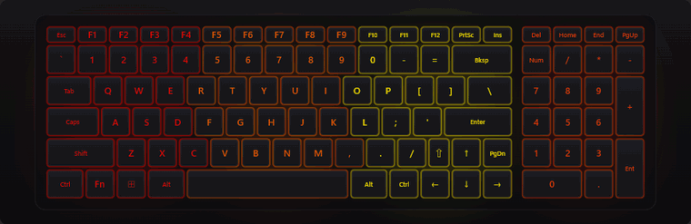

[Highlights](#highlights) · [Screenshots](#screenshots) · [Getting started](#getting-started) · [Linux](#linux) ·
[Compatibility](#compatibility) · [Plugins](#plugins) · [Building](#building) · [Code](#code) · [Full feature list](FEATURES.md)

</div>

---

## Highlights

<table>
<tr>
<td width="50%" valign="top">
<h3>🌈 Lighting</h3>
<ul>
<li>Every effect of the keyboard's four zones and the light bar's 23 LEDs, with <b>up to 7 colors</b> each</li>
<li>Effects the firmware doesn't have, drawn by the app: <b>Music, Spectrum, Typing, Star Spark</b>, and CPU, GPU and battery gauges</li>
<li><b>Live previews</b> of the keyboard and the light bar, showing what the hardware shows</li>
<li>Fine brightness in 1% steps, with smooth fades</li>
</ul>
</td>
<td width="50%" valign="top">
<h3>⚡ Performance</h3>
<ul>
<li><b>Office, Gaming and Turbo</b> modes and <b>Fan Boost</b>, from the window, the tray or the keys</li>
<li><b>Custom power limits</b> (PL1, PL2, PL4), <b>TCC offset</b>, the <b>GPU's power limit</b> and <b>Dynamic Boost</b>, up to five <b>profiles per mode</b></li>
<li>A <b>fan curve editor</b> per mode, with safety rules that keep the laptop cooled enough</li>
<li>The <b>GPU mode</b> (MUX switch): hybrid, integrated graphics only or NVIDIA only</li>
<li>Core voltage offset, with the BIOS's recovery after a failed start</li>
</ul>
</td>
</tr>
<tr>
<td valign="top">
<h3>🔋 Battery and 🖥️ display</h3>
<ul>
<li><b>High capacity, Balanced and Stationary</b> charging, battery health and charge rate</li>
<li><b>USB charging while the laptop is off</b></li>
<li><b>Display color modes</b> (Vibrant, Cinema, Low blue light, Custom) with saturation, contrast and color temperature</li>
</ul>
</td>
<td valign="top">
<h3>🧩 Everything around it</h3>
<ul>
<li><b>Setups:</b> lighting, mode and Fan Boost saved under a name, and <b>app profiles</b> that switch them while a game runs</li>
<li><b>Plugins:</b> sandboxed scripts that show Claude Code at work, downloads, songs, notifications and more on the light bar</li>
<li>A <b>hardware monitor</b>, Windows 11 <b>pop-ups</b> for the Fn keys, a <b>timer</b>, and <b>back up / restore</b></li>
</ul>
</td>
</tr>
</table>

## Screenshots

<table>
<tr>
<td width="50%">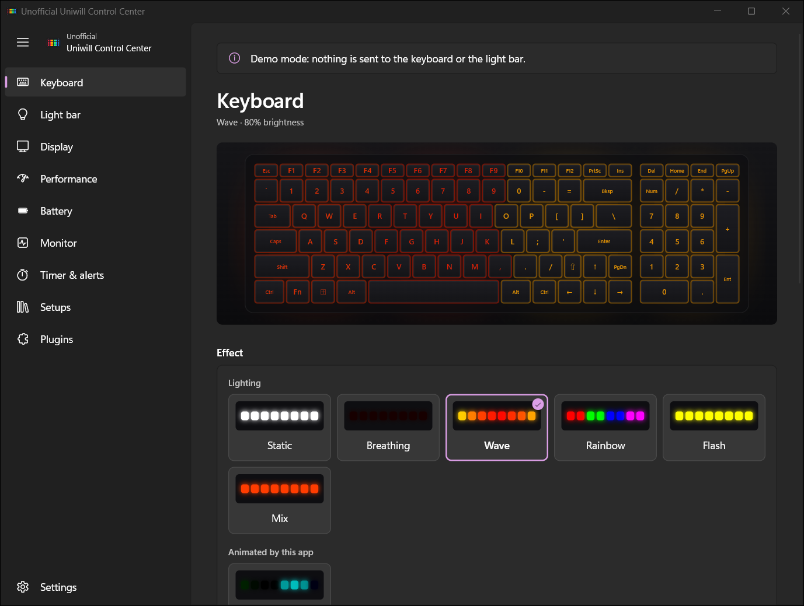<br><sub><b>Keyboard:</b> the effects, a live preview of the four zones, colors and brightness.</sub></td>
<td width="50%">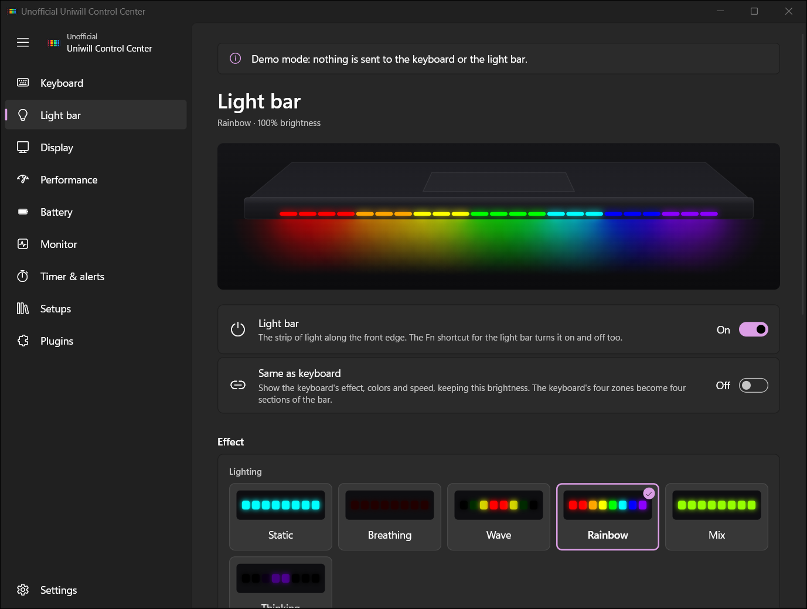<br><sub><b>Light bar:</b> its own effects, or the same as the keyboard.</sub></td>
</tr>
<tr>
<td>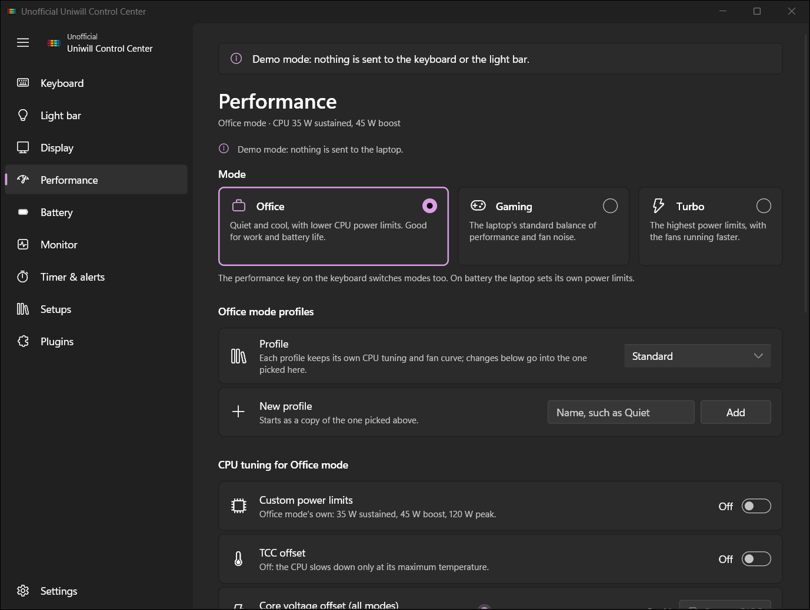<br><sub><b>Performance:</b> modes, their profiles, and the CPU and GPU tuning.</sub></td>
<td>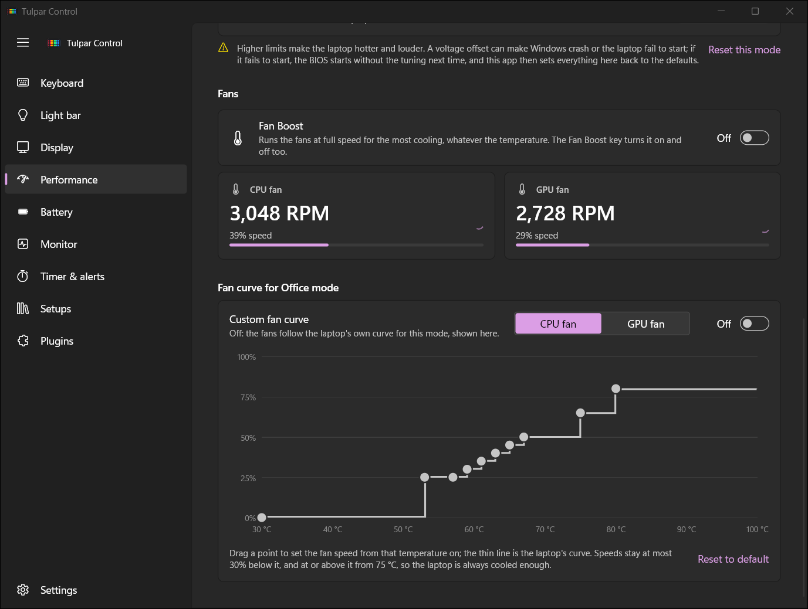<br><sub><b>Fan curves:</b> drag the points; the laptop's own curve is drawn underneath.</sub></td>
</tr>
<tr>
<td>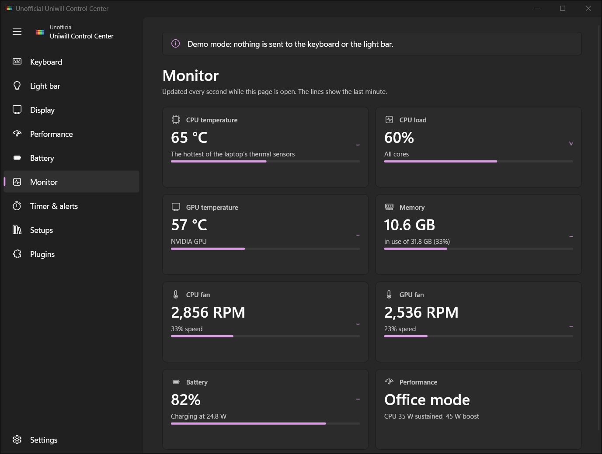<br><sub><b>Monitor:</b> temperatures, load, fans, memory and battery, with the last minute of each.</sub></td>
<td>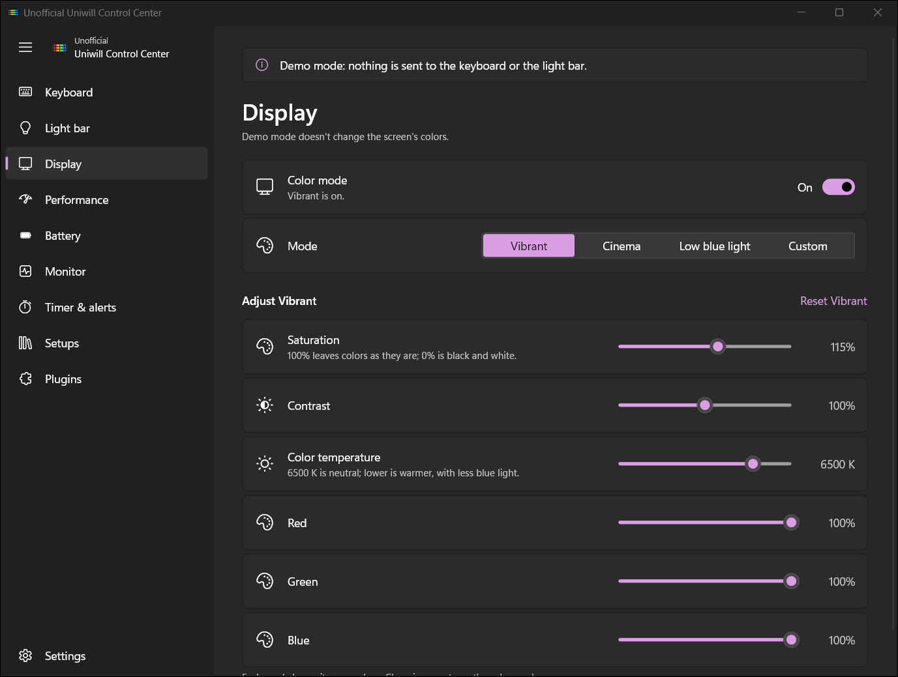<br><sub><b>Display:</b> color modes for the whole screen.</sub></td>
</tr>
<tr>
<td>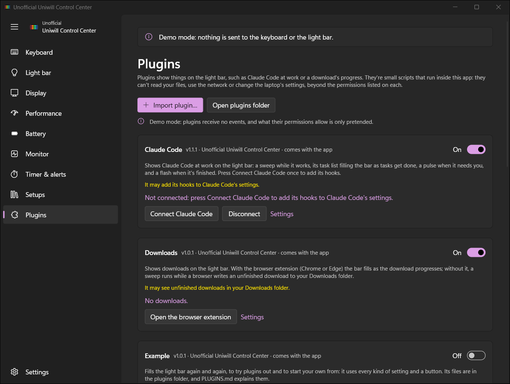<br><sub><b>Plugins:</b> turn them on and off, press their buttons, change their settings.</sub></td>
<td>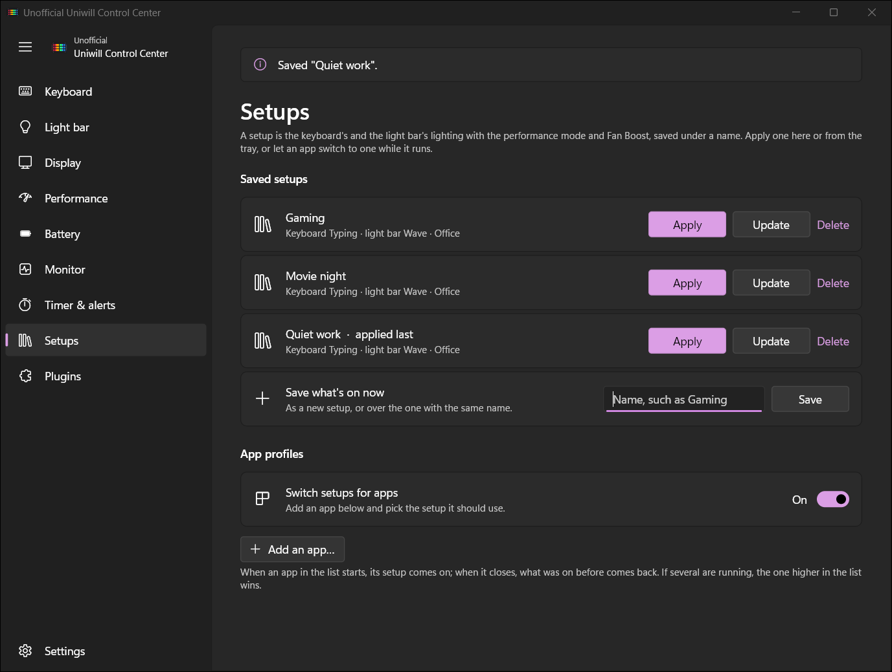<br><sub><b>Setups:</b> saved setups, and the apps that switch to one.</sub></td>
</tr>
</table>

<details>
<summary><b>More screenshots:</b> Battery, Timer & alerts, Settings, and the light bar's Wave</summary>
<br>

| Battery | Timer & alerts |
| --- | --- |
| 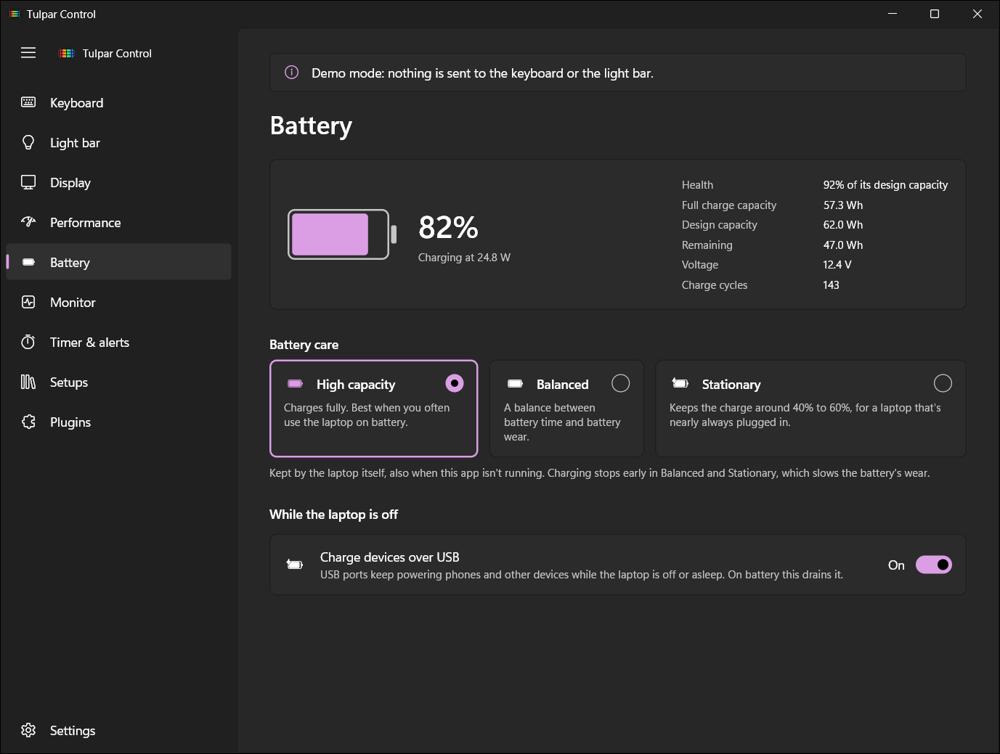 | 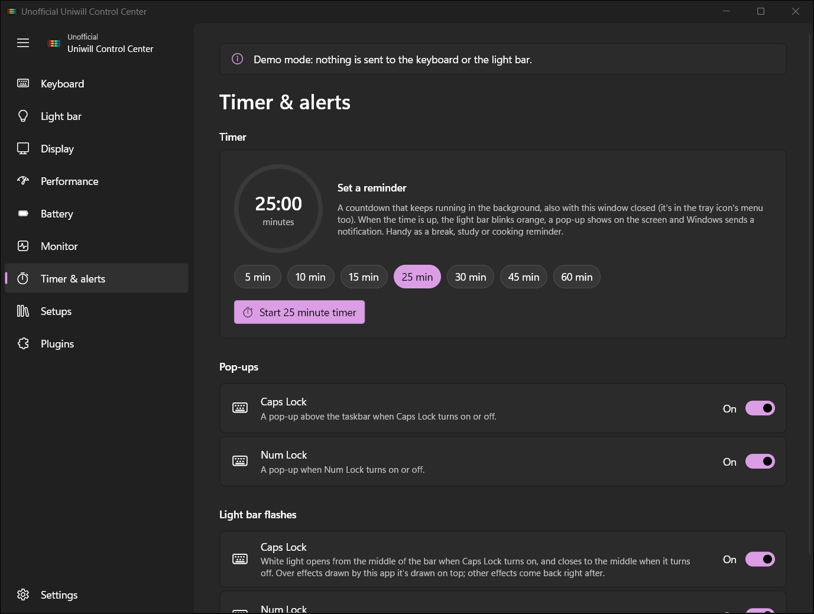 |

| Settings | The light bar's Wave |
| --- | --- |
| 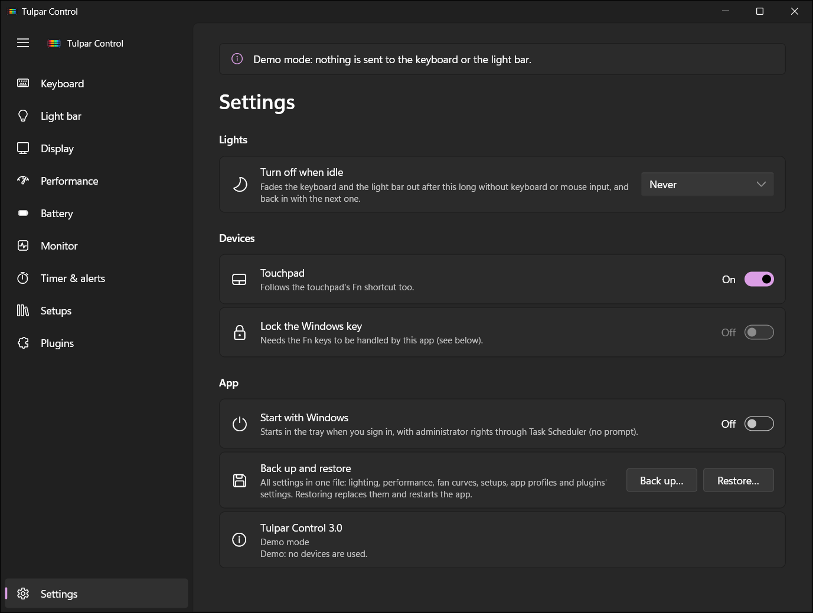 |  |

</details>

## Getting started

1. Download **`UnofficialUniwillControlCenter-<version>-Setup.exe`** from [Releases](../../releases/latest) and run it.
   - It installs to `Program Files`, adds a Start menu entry, and by default **starts the app in the tray when you
     sign in** (the same as **Start with Windows** in Settings, so it can be turned off there).
   - The installer isn't signed, so Windows SmartScreen may warn about it: choose **More info › Run anyway**.
   - Installing a new version over an old one closes the running app first, handing the Fn keys and fans back. The
     installer says it's an update (from which version to which), keeps your choices, and leaves starting with
     Windows as the app's switch has it.
2. The app needs administrator rights, because the Fn keys, the performance modes, the fans and battery care go
   through the BIOS's WMI interface. Opening it while it runs (from Start or a shortcut) just shows its window, with
   no UAC prompt. When it isn't running, it starts through its startup task with no prompt too, or asks for them if
   **Start with Windows** is off.
3. On its first start it says what it does and asks whether to go on (see [Compatibility](#compatibility)).

To keep it running without a tray icon, turn off **Show in the tray** in Settings; starting the app again opens its
window; **Exit** at the bottom of Settings closes it. Uninstalling (Settings › Apps) removes the app and its startup
task, and by default your settings and plugins too, with the hooks plugins added to Claude Code (untick that to keep
them).

> [!NOTE]
> **Control Center can stay installed.** While its service (GCUService) runs, this app leaves the Fn keys, the
> modes, the fans and battery care to it and only shows what it set. Stop the service to let this app set them.
> Once it's uninstalled, this app does everything itself.

Settings are kept in `%APPDATA%\UnofficialUniwillControlCenter\settings.json`, and **Back up…** in Settings saves them
to one file. The app was called **Tulpar Control** before 3.1: its first start moves the old
`%APPDATA%\TulparControl` folder (settings and plugins) over and replaces its startup task, and the installer updates
an installed Tulpar Control in place.

## Linux

New in 3.5.0, made on the same laptop under Fedora 44 KDE Plasma (Wayland).

**Distributions:** 64-bit x86 with glibc 2.39 or newer: Fedora 40 and later, Ubuntu 24.04 and later, Debian 13, and
distributions based on them. KDE Plasma shows the tray icon as it is; on GNOME it needs the
[AppIndicator extension](https://extensions.gnome.org/extension/615/appindicator-support/) (without it the app runs
without an icon: start it again from the app menu to open its window).

**Installing:** download the package for your distribution from [Releases](../../releases/latest) and install it:

```sh
sudo dnf install ./unofficial-uniwill-control-center-<version>-1.x86_64.rpm   # Fedora
sudo apt install ./unofficial-uniwill-control-center_<version>-1_amd64.deb     # Ubuntu, Debian
```

Then open **Unofficial Uniwill Control Center** from the app menu. Installing applies the lighting rule that gives
you the keyboard and light bar; if the lighting doesn't respond, sign out and back in once. The package installs:

- the app (`unofficial-uniwill-control-center`) and `uucc`, which run as you;
- `uucc-helper`, a small root service that systemd starts when the app first asks. It's the only part that reaches the
  embedded controller and the BIOS settings variable. It answers only users signed in at the laptop (polkit), writes
  only the EC registers the app uses, puts back the fan control if the app ends unexpectedly, and runs sandboxed;
- a udev rule that lets the person signed in use the lighting controllers.

Removing the package stops the helper and removes all of it; your settings (`~/.config/UnofficialUniwillControlCenter`)
and the autostart entry stay.

> [!IMPORTANT]
> **Secure Boot has to be off for the modes, fans, power limits and battery care.** With Secure Boot on, Fedora and
> Ubuntu put the kernel in lockdown, which blocks the direct access to the embedded controller that the helper uses.
> Check with `mokutil --sb-state`; turning it off is in the laptop's BIOS setup (usually F2 at start, under Security
> or Boot). With it on, the Performance and Battery pages say so and everything else works: the lighting, the BIOS
> settings (GPU mode, voltage offset, boot lighting) and `uucc`. A kernel module that works with Secure Boot on is
> planned.

The app also says why when the embedded controller can't be used for other reasons: the helper isn't installed or
running (`sudo systemctl enable --now uucc-helper.socket`), Linux's own `uniwill` driver is in charge of it, or the
laptop doesn't have the firmware interface this app knows.

**What works on Linux:** Office, Gaming and Turbo (the performance key too), Fan Boost, profiles per mode, power limits (PL1, PL2 and PL4, up
to the highest mode's own defaults), custom fan curves with their safety rules, battery care and USB charging, the
keyboard and light bar lighting (the firmware's effects, the effects the app draws, Smooth Wave and the status
effects), setups, the BIOS settings, the Monitor and Battery pages, the timer, `uucc`, the tray, start at login, and
backup and restore.

**Not on Linux yet:** the Fn keys and pop-ups (the firmware's hotkey events need a kernel driver), the performance
key while a custom fan curve is on (the firmware then sends it as a hotkey event), the Caps Lock and
Num Lock lights, the Typing, Music and Spectrum effects, turning the lights off when idle, plugins, app profiles,
the TCC offset and GPU power (they come from the BIOS's power limit table, which the Linux build can't read yet).
**Display color modes** won't come to Linux: Wayland has no whole-screen color setting an app can change. What
isn't there is left out of the window rather than shown broken.

## Terminal (uucc)

`uucc` changes settings and reads the status from a terminal or a script. It asks the running app, which does the
work as if its window had been clicked (the window, tray and pop-ups follow), so it needs no administrator rights.
The installer puts it on `PATH` (the **Add the uucc command to PATH** option); **open a new terminal after
installing** so it's found.

```powershell
uucc status                                   # mode, readings, battery, lighting, display, GPU mode
uucc mode turbo                               # office, gaming or turbo
uucc fan-boost on
uucc profile Standard                         # one of the current mode's profiles
uucc charge balanced                          # full, balanced or long-life
uucc setup "Night"                            # a setup saved on the Setups page
uucc keyboard --effect breathing --colors ff0000,0000ff --speed slow
uucc keyboard off                             # and `on` brings the brightness back
uucc lightbar on --linked on                  # follow the keyboard
uucc effects                                  # each effect and how many colors it takes
uucc display on --mode cinema
uucc gpu-mode hybrid                          # takes effect when the laptop restarts
```

A command without a value shows the setting. Values can be shortened while they stay unique (`uucc mode tur`).
`--json` prints the reply as JSON, for scripts; it's plain ASCII (other letters as `\uXXXX`), so it reads right
however it's captured. To capture the text output with names like "Gece Modu – Sessiz" in PowerShell, run
`[Console]::OutputEncoding = [Text.Encoding]::UTF8` first. `--start` starts the app in the tray first if it isn't running
(through its startup task, or else with a UAC prompt); without it `uucc` fails. `uucc help COMMAND` shows a command's
options.

On Linux the package puts `uucc` in `/usr/bin`. It reaches the app over a socket in your runtime folder
(`$XDG_RUNTIME_DIR/uucc.sock`, readable by you only), and `--start` starts the app in the tray. There are no display
color modes on Linux, so `uucc display` replies "Display color modes aren't available on Linux" with exit code 1, and
`uucc help` leaves it out.

| Exit code | Meaning |
|---|---|
| 0 | Done. |
| 1 | Bad command or value. The message says what's valid. |
| 2 | The app isn't running (and `--start` wasn't given), or it didn't start within 15 s. |
| 3 | The app couldn't do it: the feature isn't on this laptop, the hardware refused, or the app is busy. It prints the app's own message. |

## Compatibility

> [!WARNING]
> **Tested on one laptop: the Monster Tulpar T5 V21.4.** On any other laptop this app is **untested: use it at your
> own risk.** It changes the fans, the performance modes, the power limits and battery care by writing to the
> laptop's embedded controller (EC), at the addresses Control Center uses on this laptop. A laptop built differently
> may use them for something else, and wrong writes to the EC can make a laptop misbehave or damage it. Higher power
> limits and voltage offsets are at your own risk on any laptop.

The app doesn't check the model. It needs, and checks for:

- **The BIOS's EC interface** (`AcpiTest_MULong` in WMI), which laptops shipped with Uniwill's Control Center have. It
  turns on only what the EC reports, such as Turbo mode, the custom fan tables and USB charging.
- **For lighting, ITE controllers:** a four-zone keyboard (USB `048D:CE00` or `048D:6000`–`600A`) and a light bar
  (`048D:6005`, `6008` or `6010`). Per-key RGB and white-only keyboards use other controllers and aren't supported.

On its first start it shows what it does and asks whether to go on, naming your laptop if it isn't the tested one.

**Laptops on the same platform, all untested.** Uniwill designs and builds laptops for many brands, often sold as
Tongfang barebones. The Linux kernel's [uniwill-laptop driver][uniwill-driver] lists these as sharing its EC
interface, though not necessarily the same addresses:

| Brand | Models |
| --- | --- |
| Monster / Tulpar | Other Tulpar models on Uniwill/Tongfang boards, such as the [Tulpar T7 V20.6 (Tongfang GM7PG0R)][t7] |
| XMG / Schenker | XMG Fusion 15 (L19) |
| TUXEDO | Polaris, Stellaris, Trinity, Pulse and InfinityBook Pro models (sold with Linux) |
| Others | Avell A60 MUV, Machenike L16 Pro, AiStone X4SP4NAL, Intel NUC X15, Commodore Omnia-Book and ORION |

If you try it on one of them, which features worked (and which didn't) is useful to hear.

[uniwill-driver]: https://docs.kernel.org/wmi/devices/uniwill-laptop.html
[t7]: https://www.notebookcheck.net/Tulpar-T7-V20-6-Tongfang-GM7PG0R-laptop-review-Currently-one-of-the-cheapest-RTX-4060-gamers.840678.0.html

## Plugins

Plugins are small [Rhai](https://rhai.rs) scripts that show things on the light bar. They can't read files, use the
network or start programs, beyond the permissions listed on their card.

| Plugin | What it shows |
| --- | --- |
| **Claude Code** | A sweep while Claude works, its task list filling the bar, a pulse when it needs you |
| **Downloads** | Download progress from a Chrome/Edge extension |
| **Focus timer** | Pomodoro rounds filling and emptying the bar |
| **Media** | The song's progress, and the volume when it changes |
| **Microphone** | A red glow while the microphone is muted |
| **Notifications** | A flash for new notifications from the apps you choose |
| **Temperature alert** | A red pulse while the CPU or GPU is too hot |
| **Example** | A template for writing your own |

More can be imported from a `.zip`. [PLUGINS.md](PLUGINS.md) explains how to write one:

```rust
fn on_event(path, body) {
    if path == "/done" {
        flash(if body.ok { "#4CAF50" } else { "#E53935" });
    }
}
```

## Building

Needs Rust (MSVC toolchain) and the Windows SDK (for the icon and manifest).

```
cargo build --release
```

The app is `target\release\UnofficialUniwillControlCenter.exe`, a single file with nothing else to install. `cargo test` checks the fan
curve rules, the BIOS variable edits, the display color math and the plugins (every bundled script included).

To build the installer as well, install [Inno Setup 6](https://jrsoftware.org/isinfo.php)
(`winget install JRSoftware.InnoSetup`) and run:

```
powershell -ExecutionPolicy Bypass -File installer\build.ps1
```

It builds the app and writes `dist\UnofficialUniwillControlCenter-<version>-Setup.exe`, with the version from `Cargo.toml`.

<details>
<summary><b>Demo mode:</b> trying the window without touching the hardware</summary>
<br>

```
set CARGO_TARGET_DIR=target-demo
cargo build --release
target-demo\release\UnofficialUniwillControlCenter.exe --demo
```

- `--demo` opens no devices, sends nothing to the embedded controller, shows made-up readings, saves nothing and
  skips the first-start question.
- `--page N` opens on a page: 0 Keyboard, 1 Light bar, 2 Timer & alerts, 3 Settings, 4 Performance, 5 Battery,
  6 Monitor, 7 Plugins, 8 Setups, 9 Display.
- `--tray` starts in the tray, and `--osd-test` shows the pop-ups once.
- For the installer: `--enable-startup` and `--disable-startup` add or remove the startup task, and `--exit` closes
  the running app as its Exit menu does and waits until it's gone. `--remove-data` removes the settings and plugins
  (also from the app's earlier names) and the plugins' Claude Code hooks, for the uninstaller, which closes the app
  first. A silent uninstall keeps them unless `/REMOVEDATA` is given.

</details>

## Code

<details>
<summary><b>A map of the code</b></summary>
<br>

| Folder / file | What it does |
| --- | --- |
| `src/main.rs` | Start-up, the single-instance lock, the renderer and the crash handler. |
| `src/app/mod.rs` | The window, the tray, the lighting and the Fn keys: everything the UI thread does. |
| `src/app/power.rs` | Performance modes and their profiles, Fan Boost, fan curves and battery care, and the performance keys. |
| `src/app/monitor.rs` | The readings thread and the Monitor page. |
| `src/app/bios.rs` | Startup lighting, the CPU voltage offset and recovery after a failed start, kept in the BIOS. |
| `src/app/setups.rs` | Saved setups and app profiles: saving, applying, and switching while a program runs. |
| `src/app/display.rs`, `src/shell/display.rs` | The Display page's color modes, and their color matrix put over the screen. |
| `src/app/backup.rs` | Backing up all settings to a file and restoring them. |
| `src/app/plugins.rs` | The Plugins page: starting and stopping plugins, their settings, importing and removing them. |
| `src/lighting/` | The ITE controllers over HID (`device.rs`), the effect lists, the effects engine and scenes, audio, the previews and the keyboard hook. |
| `src/hardware/ec.rs` | The embedded controller's RAM through WMI, on one thread. |
| `src/hardware/hotkeys.rs` | Taking the Fn keys over from the EC and listening for hotkey events. |
| `src/hardware/performance.rs`, `fans.rs`, `battery.rs` | The EC registers for modes, power limits, TCC offset and GPU power, fan tables and speeds, and charging. |
| `src/hardware/uefi.rs` | Control Center's UEFI variable, read and changed field by field. |
| `src/hardware/status.rs`, `system.rs` | Temperatures, loads, memory and battery readings; touchpad, startup task and registry. |
| `src/shell/` | The pop-up (Direct2D on a layered window), the tray icon and menu, file pickers and the display color effect. |
| `src/plugins/` | The plugin manifest (`manifest.rs`), the plugins folder and imports (`store.rs`), the script thread and its API (`host.rs`), the light bar layers (`layers.rs`), the local events server (`server.rs`), Windows readings for scripts (`readings.rs`: temperatures, media, volume, microphone, notifications), and what permissions allow (`claude.rs`, `downloads.rs`). |
| `plugins/` | The plugins that come with the app: Claude Code, Downloads with its browser extension, Example, Focus timer, Media, Microphone, Notifications and Temperature alert. |
| `ui/*.slint` | The window, in Slint; `power.slint` has the Performance, Battery and Monitor pages, `plugins.slint` the Plugins page, `setups.slint` the Setups page, `display.slint` the Display page. |
| `installer/` | The Inno Setup script and `build.ps1`, which builds the app and the installer. |
| `docs/images/` | The screenshots in this README, taken in demo mode. |
| `tools/` | PowerShell scripts used to test the embedded controller's behavior. |

</details>

---

<div align="center">
<sub>Not affiliated with Uniwill, Tongfang, Monster Notebook or any laptop maker. Control Center is Uniwill's; this app was written by studying how it talks to the hardware.</sub>
</div>
